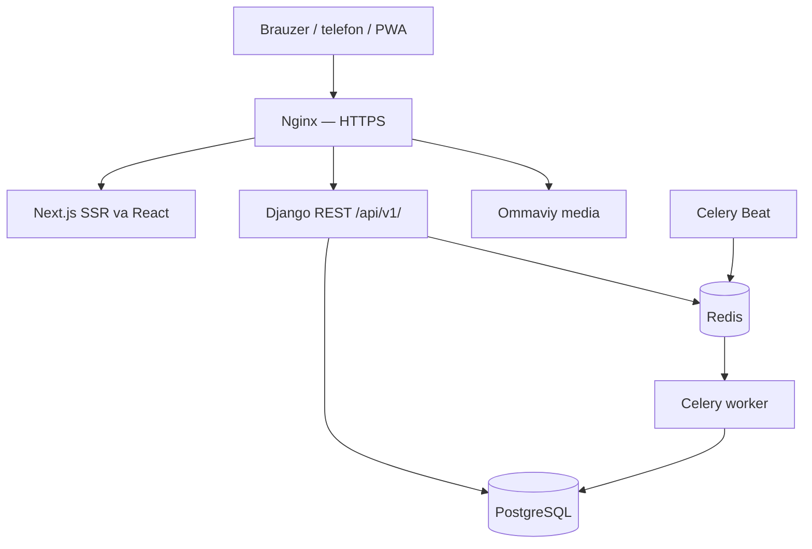

# Arxitektura

Bitta modulli Django backend va Next.js App Router frontend. Brauzer faqat bir origin bilan ishlaydi. Redis asosiy biznes ma’lumotini saqlamaydi.

Yozish operatsiyalari serverdagi service qatlamida. Ruxsat va obyekt doirasi API’da tekshiriladi. Moliya: atomik tranzaksiya, student/invoice row lock, idempotency va unique constraint. Jadval: PostgreSQL transaction advisory lock bilan xona va ustoz resurslari ketma-ket qulflanadi; bir-birini kesuvchi interval tekshiriladi. Barcha o‘zgartirishlar bir xil service yo‘lidan o‘tadi.

Private HTML/API `no-store`. Service worker faqat statik ikonalar va offline sahifani saqlaydi; kabinet yoki API’ni keshlamaydi. Session HttpOnly, CSRF cookie va header. Production Secure/SameSite=Lax, aniq host/origin.
