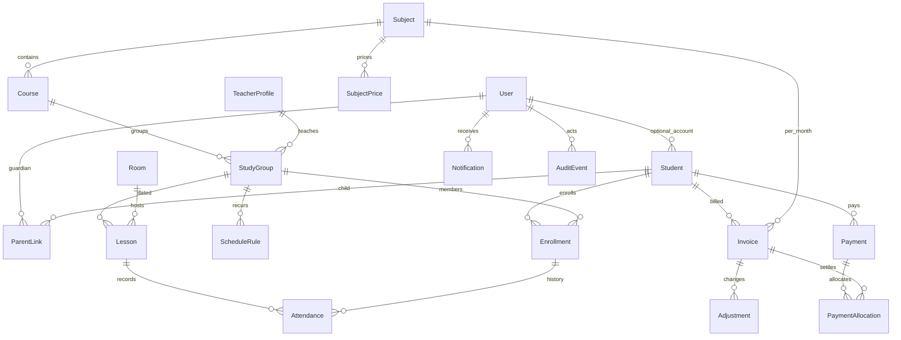

# Ma’lumotlar modeli

Profil akkauntdan alohida. Telefon noyobligi faqat User’da; bolalar kontaktlari takrorlanishi mumkin. Muhim tarixiy FK’lar PROTECT. Enrollment yakunlanadi, o‘chirilmaydi. Invoice student/subject/month bo‘yicha noyob. Attendance lesson/student bo‘yicha noyob. Payment idempotency key noyob. Notification dedupe_key noyob. Kodlar xeshlangan, muddati va urinishlar sanog‘i bilan saqlanadi.

## Ustozga to‘lovlar

`TeacherPayment` ustozga berilgan oylik/avansning alohida xarajat registri. `teacher`, `entered_by` tarixiy PROTECT bog‘lanishlar; `month` davrning birinchi sanasi, `paid_on` haqiqiy sana, `amount` musbat Decimal(14,2), `note` izoh. Noyob UUID va fingerprint qayta yuborishni ajratadi. `POSTED/VOID`, bekor qilgan xodim, sabab va vaqt saqlanadi. Migratsiya `billing.0004_teacher_payments` faqat yangi jadval qo‘shadi; mavjud o‘quvchi hisobi va to‘lovlarini o‘zgartirmaydi.

## Markaz va yutuqlar kontenti

`SiteSettings` banner matni, tanishtiruv, missiya, ta’lim yondashuvi, sharoitlar, qabul bosqichlari, banner va ichki muhit rasmlarini saqlaydi. Kontent ochiq sayt va kabinetda umumiy manbadan o‘qiladi.

`Achievement.teacher` ustozga ixtiyoriy `PROTECT` bog‘lanish; `achieved_on` sertifikat sanasi. Fan va ustoz mosligi serializerda tekshiriladi. E’lon qilishda rozilik, maxfiylik tekshiruvi va haqiqiy rasm talab qilinadi.

`Achievement.score` ball yoki darajaning qisqa matni (`57 ball · B2` kabi); `is_sample` ko‘rinish namunasini haqiqiy mustaqil natijadan ajratadi va public API’da ham qaytadi. `content.0008` faqat shu ikki maydonni qo‘shadi: eski natijalar balli bo‘sh, namuna belgisi false qoladi. Ustoz berilmasa yangi ustoz yoki soxta bog‘lanish yaratilmaydi.

`Achievement.student` ixtiyoriy `PROTECT` FK (`Student.certificates`). `content.0009` avvalgi natijalarda NULL qoldiradi: ism o‘xshashligidan avtomatik bog‘lanish yaratilmaydi. Boshqaruv API’da `student` va `student_name` bor, public serializerga ichki profil ID yoki nomi qo‘shilmagan. O‘quvchilar filtri haqiqiy rasmli, `is_sample=False` yozuvlar bo‘yicha `Exists` subquery ishlatadi. Xuddi shu ruxsatli sertifikatlar `Prefetch` orqali olinadi; ro‘yxatdagi fan/nom/ball uchun har o‘quvchiga alohida so‘rov yuborilmaydi.

`TeacherProfile.experience_years`, `students_taught`, `qualifications` ommaviy profilni to‘ldiradi. Tasdiqlangan lifetime son bo‘lmasa, `Count(groups__enrollments__student_id, distinct=True)` hisoblanadi. Ushbu hisoblash talaba shaxsiy ma’lumotlarini public serializerga qo‘shmaydi.

## Sertifikatlarni papkadan bog‘lash

`Achievement.import_key` — ixtiyoriy noyob manba kaliti (`english/01` kabi), ommaviy/API forma maydoni emas. `content.0007` mavjud yozuvlarga `NULL` qo‘shadi. Paneldagi eski natijalar saqlanadi, import faqat shu kalit bilan bog‘langan natijani yangilaydi. Manba `certificates/<subject-slug>/certificates.json`; rasmlar mavjud xavfsiz serializer orqali media nusxasiga aylantiriladi. Roziliksiz nashr, noto‘g‘ri rasm yoki fan/ustoz mos kelmasligi importdan oldin rad etiladi.

Import bir fan uchun 1–40 oralig‘idagi noyob slotlarni qabul qiladi. Bitta importda bir xil manba rasmi ishlatilsa yozuvlar bitta tozalangan media fayliga bog‘lanadi; rollback yangi saqlangan fayllarni bir marta tozalaydi. Qayta import o‘zgarmagan yozuv/rasmlarni qayta yaratmaydi.
